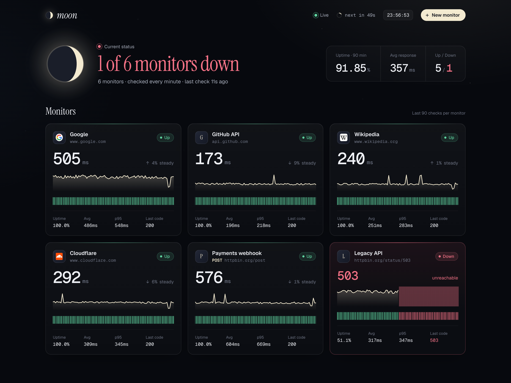
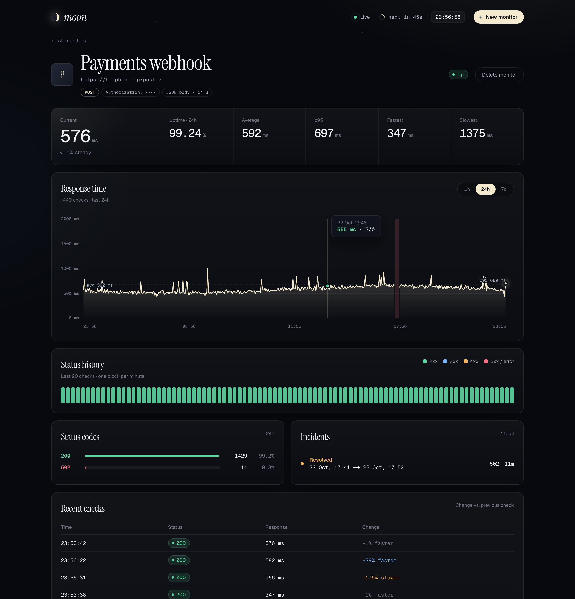
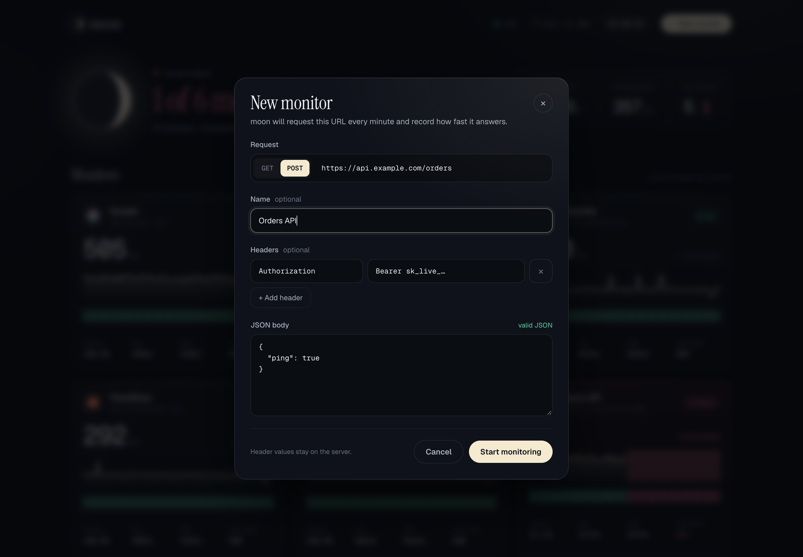

# moon

A self-hosted uptime and response-time monitor. Add a website or API, moon requests it every minute, records how fast it answers and which status code it returns, and streams every result to the dashboard live.



## Features

- **Checks every minute.** Each check records the response time (time to first byte), the status code and, on failure, the reason (`timeout`, `ENOTFOUND`, `ECONNREFUSED`…).
- **Where the time goes.** Every check is split into DNS lookup, TCP connect, TLS handshake and server response (plus redirects), so you can see *why* a site is slow.
- **SSL certificates.** The certificate is read on every HTTPS check; issuer, expiry date and days left are shown on the card and the detail page.
- **Answering IP.** The IP address that served each check, after following redirects.
- **Live dashboard.** New results arrive over socket.io; no refresh needed.
- **Faster / slower.** Every reading is compared with the median of the previous hour and flagged as *faster*, *steady* or *slower*.
- **Status code history.** One block per check, colored by 2xx / 3xx / 4xx / 5xx-or-error.
- **Incidents.** Consecutive failures are grouped into incidents with start, end and duration.
- **GET or POST, custom headers, JSON body.** Header values and request bodies stay on the server and are never sent to the browser.
- **Edit without losing history.** Change a monitor's URL, method, headers or body; its check history stays. Stored header values and body are kept unless you type new ones.
- **Tabs.** Create tabs on the dashboard and pick the monitors that belong in each.
- **Your order.** Drag cards into a custom order, or sort by name, status, uptime or response time.
- **Public status page.** `/status` shows each service's daily uptime for the last 30 days, grouped by tab, with no controls and no URLs.
- **Moon phase = uptime.** The moon on the dashboard is full at 100% uptime and wanes towards a new moon at 90% or below.





## Install with Docker Compose

Requirements: Docker with the Compose plugin.

```sh
git clone https://github.com/yasaricli/moon.git
cd moon
docker compose up -d --build
```

Open **http://localhost:3000** and click **New monitor**.

That's it: Compose starts MongoDB and the app, waits for MongoDB to be healthy, and restarts both if they crash. Data is kept in the `mongo-data` volume; individual checks expire after 30 days.

Common commands:

```sh
docker compose logs -f app          # follow the app logs
docker compose down                 # stop (data is kept)
docker compose down -v              # stop and delete all data
```

### Local settings

Keep your own changes out of `compose.yaml` so updates never conflict. Put them in `compose.override.yaml` next to it; Compose merges that file automatically and git ignores it. For example, to serve on port 8080:

```yaml
# compose.override.yaml
services:
  app:
    ports: !override
      - "8080:3000"
```

## Updating

moon is under active development. To move an existing install to the latest version, run this in the `moon` folder:

```sh
git pull
docker compose pull mongo
docker compose up -d --build
```

- `git pull` fetches the new code.
- `docker compose pull mongo` picks up MongoDB patch releases (the image is pinned to major version 8).
- `docker compose up -d --build` rebuilds the app image and replaces the running container. MongoDB keeps running, so monitors and check history stay in the `mongo-data` volume; there is no migration step. The dashboard reconnects on its own after the restart, and checking resumes within a minute.

Check which version you're on with `git log -1 --oneline`. To go back to an earlier version, check out that commit and rebuild:

```sh
git checkout <commit>
docker compose up -d --build
```

Old app images pile up after a few updates; `docker image prune -f` removes the unused ones.

> **Monitoring something on the same machine?** Inside the container `localhost` is the container itself. Use `http://host.docker.internal:<port>` instead (on Linux, add `extra_hosts: ["host.docker.internal:host-gateway"]` to the `app` service).

## Configuration

Both variables are required; the app exits with `missing env X` if one is absent. Compose sets them for you.

| Variable      | Example                              |
| ------------- | ------------------------------------ |
| `MONGODB_URI` | `mongodb://localhost:27017/moon`     |
| `PORT`        | `3000`                               |

## Local development

Requires Node.js 24 and a running MongoDB.

```sh
cp .env.example .env
npm install
npm run dev     # http://localhost:3000
npm test        # stats self-check
```

## How it works

A single Node process (`server.js`) runs Next.js, socket.io and the checker loop together. Every 60 seconds it requests all monitors in parallel with a 10 second timeout, stores each result in MongoDB and broadcasts it to connected browsers. Any status of 400 or above counts as down.

Stack: Next.js, React, SCSS modules, socket.io, MongoDB (mongoose).
